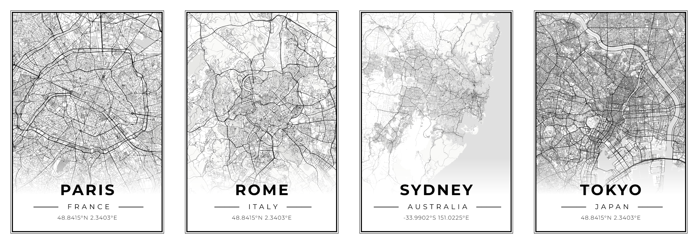

<p align="center">
  
</p>

<h1 align="center">Map2Poster</h1>

<p align="center">
  A client-side map poster generator — no install, no account, no API key.<br/>
</p>

<p align="center">
  <a href="https://dim4k.github.io/map2poster/"></a>
</p>

<p align="center">
  <a href="#-features">Features</a> •
  <a href="#-quick-start">Quick Start</a> •
  <a href="#%EF%B8%8F-tech-stack">Tech Stack</a>
</p>

<p align="center">
  
</p>

## ✨ Features

- **10 poster styles** — Classic, Blueprint, Vintage, Midnight, Swiss, Botanical, Modern, Ocean, Asphalt, Neon
- **Map shapes** — Rectangle, Circle, Heart, Star
- **Label placement** — Bottom, Top, Center, Split
- **Search any place** — pick from a list of results; optionally keep your own poster title
- **Full color control** — Borders, text, background, water, roads, parks, land, buildings, with hex validation and per-color reset
- **Safe style switching** — browse styles with ← / →; if a style replaces your custom colors, one click on Undo brings them back
- **Typography** — 7 fonts, independent per label (city, country, coordinates); long city names shrink to fit the frame
- **Orientation** — Portrait & Landscape
- **Gradient fade** — Adjustable intensity and solid block height
- **High-res export** — A1 to A4 at 300 or 150 dpi (A1 300 dpi = 7000×9900 px); the map itself is rendered at the export resolution, and shaped maps (circle, heart, star) are exported as shown
- **Privacy** — Entirely client-side, no data collection

## 🚀 Quick Start

**Online** — open [dim4k.github.io/map2poster](https://dim4k.github.io/map2poster/) in your browser.

**Local** — clone and open `index.html`:

```sh
git clone https://github.com/dim4k/map2poster.git
```

No build step. Works with any static file server (for example `npm start`, which runs `python -m http.server 8000`).

**Tests** — pure helpers (colors, PNG dpi, export sizes, theme config) are covered with Node's built-in test runner:

```sh
npm test   # Node 22+
```

## 🛠️ Tech Stack

| Layer  | Tool                                                        |
| ------ | ----------------------------------------------------------- |
| UI     | [Vue 3](https://vuejs.org/) (Composition API)               |
| Maps   | [MapLibre GL JS](https://maplibre.org/)                     |
| Tiles  | [OpenFreeMap](https://openfreemap.org/) (free, no key)      |
| Search | [Nominatim](https://nominatim.org/) (OpenStreetMap)          |
| Export | MapLibre canvas + [html2canvas](https://html2canvas.hertzen.com/) for the frame and labels |

## ⚖️ Credits

Map data © [OpenStreetMap contributors](https://www.openstreetmap.org/copyright), tiles by [OpenFreeMap](https://openfreemap.org/) and [OpenMapTiles](https://openmaptiles.org/). The poster carries a small OpenStreetMap credit by default (Labels → Visibility → © OSM); keep it when you share or sell prints.

## 📝 License

This project is open source and available under the MIT License.

---

<p align="center">Made with ❤️ for beautiful map posters.</p>
